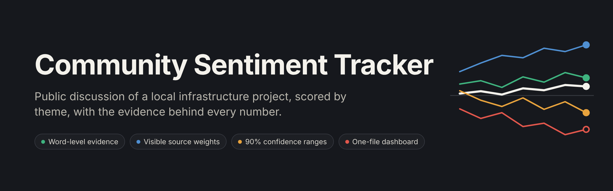
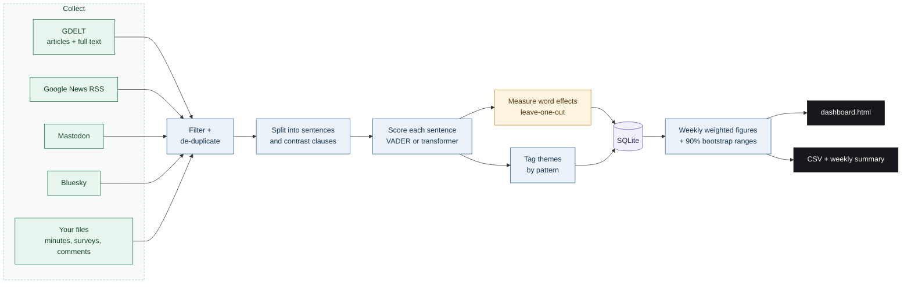
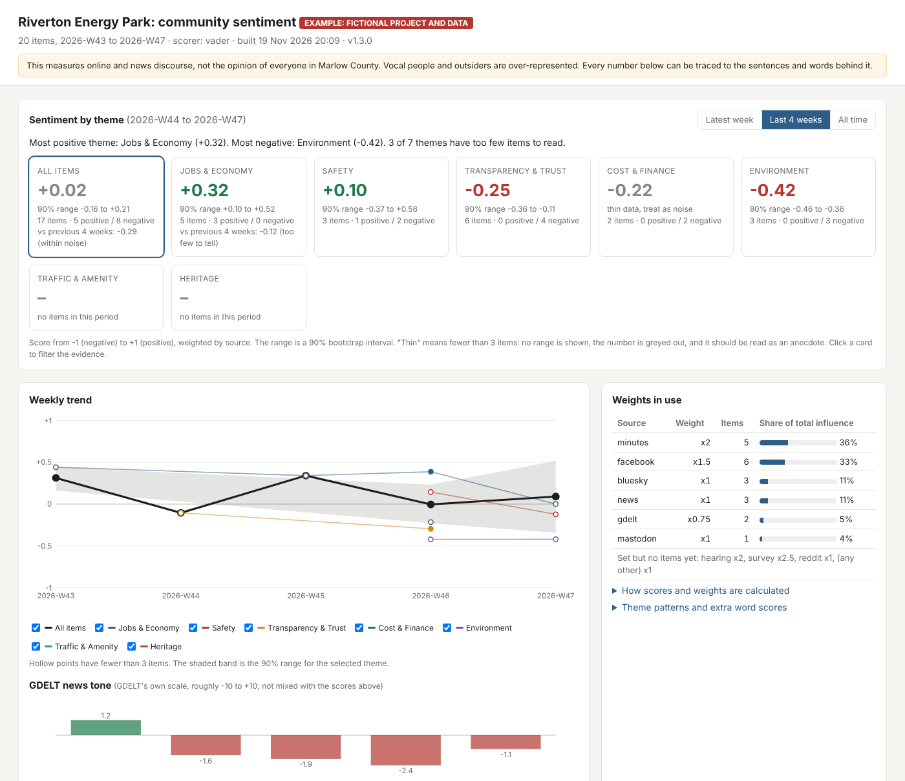
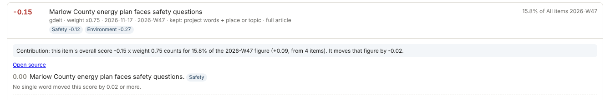

<p align="center">
  
</p>

<p align="center">
  <a href="https://github.com/davevoigts/community-sentiment-tracker/actions/workflows/tests.yml"></a>
  
  
  
</p>

<p align="center">
  <a href="#quick-start">Quick start</a> ·
  <a href="#how-it-works">How it works</a> ·
  <a href="#the-dashboard">The dashboard</a> ·
  <a href="#sources">Sources</a> ·
  <a href="docs/GETTING_STARTED.md">Set up your project</a> ·
  <a href="docs/METHOD.md">Method</a> ·
  <a href="#limitations">Limitations</a>
</p>

---

Track what is being said in public about a local infrastructure project, score it by theme, and **see the evidence behind every number**: which words drove each score, how much each source counts, and how sure each figure is.

It works for any project that people talk about in public: a power plant, a wind farm, a road, a data centre, a housing scheme. You describe your project in one small settings file, and the tool does the rest.

> [!IMPORTANT]
> This measures **online and news discourse**, not the opinion of the people who live near a project. Vocal people and outsiders are over-represented online. Use surveys and local meeting records (imported here with extra weight) for anything closer to local opinion.

## Highlights

| | |
|---|---|
| **Sentence-level scoring** | Comments are split at "but", "however" and ", while", so *"great for jobs but nobody told us"* counts as positive on jobs **and** negative on transparency. |
| **Word-level evidence** | Each word is removed in turn and the sentence re-scored. The dashboard colours every word by its measured effect. |
| **Visible weights** | Local records count double, headline-only sources less. Every item shows its share of each weekly figure. |
| **Honest uncertainty** | Each figure has a 90% bootstrap range. Changes are labelled *within noise* or *likely shift*, and figures from fewer than 3 items are greyed out. |
| **Check it yourself** | Export a sample, label it by hand, and `validate` reports how often the model agrees with you. |
| **Clean data** | The same story from two sources is kept once, full-text version first. Off-topic matches are filtered out. |
| **Filters you control** | Optional filters hide other languages, hashtag-heavy bot posts, reposts and blocked phrases. They hide without deleting, and each can be switched off. |
| **Guards against loose settings** | Preview what would be collected before storing anything. Warnings appear when settings look too loose, and every item says why it was kept. |
| **No infrastructure** | One Python file, a local SQLite database, and a dashboard that is a single HTML file. No server, no account, no cloud. |

## Quick start

Requires Python 3.9 or later.

```bash
git clone https://github.com/davevoigts/community-sentiment-tracker.git
cd community-sentiment-tracker
python3 -m venv .venv && source .venv/bin/activate   # Windows: .venv\Scripts\activate
pip install -r requirements.txt

python sentiment_tracker.py demo         # load a few fictional items
python sentiment_tracker.py dashboard    # build and open dashboard.html
rm tracker.db                            # clear the sample before real use
```

Then set up your own project and collect real data:

```bash
python sentiment_tracker.py init               # answer nine questions about your project
python sentiment_tracker.py collect --preview  # see what would be kept and rejected; stores nothing
python sentiment_tracker.py collect            # fetch new items from every source
python sentiment_tracker.py dashboard    # open the results
```

`init` asks for the project's name, its area and what kind of project it is (nuclear plant, wind farm, solar farm, road, housing, data centre, pipeline or something else). It then writes `project.json`, with search terms and theme words to suit. **[Set up your own project](docs/GETTING_STARTED.md)** walks through it step by step. Every setting is described in [docs/CONFIG.md](docs/CONFIG.md), and [`examples/project.example.json`](examples/project.example.json) is a fuller example. The example project is fictional.

Want to see it first? Download [`examples/dashboard_sample.html`](examples/dashboard_sample.html) and open it in a browser. It was built from fictional data.

## How it works



Weekly figure for a theme = sum(item score × source weight) / sum(source weights). Each item counts once, whatever its length. The full method, its assumptions and a worked example are in **[docs/METHOD.md](docs/METHOD.md)**.

## The dashboard

<p align="center"></p>

- **Theme cards**: the score per theme for the latest week, the last 4 weeks or all time, with its 90% range, item count and change from the period before. A one-line takeaway names the most positive and most negative themes that have enough items to read.
- **Weekly trend**: one line per theme. Hollow points mark thin weeks; the shaded band is the selected theme's range.
- **Weights in use**: each source's weight and its share of total influence.
- **Evidence explorer**: filter by week, theme, source and tone. Open any item to see each sentence, its score, the words that drove it, and the item's exact contribution to the weekly figure.

<p align="center"></p>

## Checking the scoring

No sentiment model is right every time, so the tool lets you measure it on your own data:

```bash
python sentiment_tracker.py sample 50 --export labels.csv   # 50 random items
# open labels.csv, fill in your_label: positive / negative / neutral
python sentiment_tracker.py validate labels.csv
```

`validate` prints how often the model agrees with you, how often it makes the opposite call, and every disagreement. If the result is poor, adjust the `lexicon` in `project.json` or switch scorer, run `rescore`, and validate again against the same labels.

## Commands

| Command | What it does |
|---|---|
| `init` | Answer nine questions to set up your project. Writes `project.json`. |
| `init NAME [--area A] [--place P ...] [--type T] [--topic W ...] [--exclude W ...] [--since YYYY-MM] [--strict] [--no-filters]` | The same, without the questions. |
| `collect --preview` | Store nothing. Show a sample of what your settings would keep, and why, and what they would reject. |
| `check` | Warn about settings that look too loose. Also runs after every `collect`. |
| `collect [--headlines-only]` | Fetch, score and store new items. Fetches GDELT article text unless told not to. |
| `import FILE --source NAME --date YYYY-MM-DD` | Add a `.txt` (one item per paragraph; `#` lines ignored) or `.csv` (`text`, plus optional `date`, `speaker`, `url`). |
| `dashboard [--no-open]` | Build `dashboard.html`. |
| `report` | Write `weekly_report.csv` and `evidence.csv` (every sentence, score and word effect). |
| `summary` | This week against last week, in `weekly_summary.md`. |
| `sample [N] [--theme T]` | Print N random scored items to check the scoring by hand. |
| `sample N --export FILE` | Write N items to a CSV with an empty `your_label` column. |
| `validate FILE` | Compare your labels with the model's: agreement rate, a confusion table, and each disagreement. |
| `rescore` | Re-score everything already stored, after you change themes, word scores or the scorer. |
| `prune [--apply]` | List collected items your current settings would not keep; with `--apply`, remove them. |
| `demo` | Load sample text to try things offline. |

## Sources

| Source | Access | Notes |
|---|---|---|
| GDELT DOC API | Open, rate-limited | Article text extracted where possible. Backs off and retries on HTTP 429. |
| GDELT tone | Open | GDELT's own scale (about -10 to +10). Shown separately, never mixed in. |
| Google News RSS | Open | Headline only, because the links are encoded redirects. |
| Mastodon | Open | Hashtag timelines on one instance (default `mastodon.social`). |
| Bluesky | Free app password | Set `BSKY_HANDLE` and `BSKY_APP_PASSWORD`. |
| Your files | Local | Meeting minutes, transcripts, surveys, comments copied by hand. |
| Reddit | Not collected | New API keys are limited to moderation use. Import copied comments as CSV. |
| Facebook, X | Not collected | Facebook forbids scraping; the X API is paid. |

More in [docs/SOURCES.md](docs/SOURCES.md), including how to add a source.

## Configuration

Everything about your project lives in **`project.json`**. Nothing in the code needs editing. Full reference: [docs/CONFIG.md](docs/CONFIG.md).

```json
{
  "project_name": "Riverton Energy Park",
  "area_name": "Marlow County",
  "relevance": {
    "place_terms": ["marlow county", "riverton"],
    "topic_terms": ["energy", "power plant"]
  },
  "theme_additions": { "safety": ["explosion", "fire risk"] },
  "source_weights": { "survey": 2.5 }
}
```

<details>
<summary><b>What counts as relevant</b></summary>

An item is kept if it names the project exactly as written, or uses the project's words together with a place or topic word, or names a place together with a topic word. Use `exclude_terms` when another organisation shares the name, `"strict": true` when the name is made of everyday words, and `start_date` to ignore anything from before the project existed. Full rules: [docs/CONFIG.md](docs/CONFIG.md). How to spot and fix loose settings: [Tighten what gets collected](docs/GETTING_STARTED.md#tighten-what-gets-collected).
</details>

<details>
<summary><b>Filters</b></summary>

Switch these on under `filters` to hide noise. `init` offers the set below. Nothing is filtered unless you ask for it, imported files are never filtered, and hidden items are kept in the database until you `prune`.

```json
"filters": {
  "languages": ["en"],
  "max_hashtags": 3,
  "collapse_reposts": true,
  "min_words": 4,
  "block_phrases": ["sponsored"],
  "skip_sources": []
}
```

Details: [docs/CONFIG.md](docs/CONFIG.md#filters).
</details>

<details>
<summary><b>Themes</b></summary>

Six themes come built in: jobs and economy, safety, transparency and trust, cost and finance, environment, and traffic and amenity. In `project.json`:

- `theme_additions` adds patterns to a theme (or creates a new one).
- `themes` replaces a theme's patterns, or removes the theme when set to `null`.

Patterns match at the start of a word, so `job` matches "jobs" but `pace` does not match "space". Run `python sentiment_tracker.py rescore` after changing themes, so stored items pick up the change.
</details>

<details>
<summary><b>Source weights</b></summary>

| Source | Default weight | Why |
|---|---|---|
| minutes, hearing, survey | 2.0 | Closest record of what residents said |
| facebook | 1.5 | Mostly local, but self-selected |
| bluesky, mastodon, reddit | 1.0 | Public posts; authors may not be local |
| news | 1.0 | Headline only |
| gdelt | 0.75 | Overlaps Google News |

Override any of them under `source_weights`. Changes apply the next time the dashboard is built, with no new collection needed.
</details>

<details>
<summary><b>Scoring</b></summary>

- `lexicon` adds or overrides word scores (-4 to +4). By default "safety" is 0, because in a planning debate it names the topic rather than praising it.
- `SCORER=transformer` switches to `cardiffnlp/twitter-roberta-base-sentiment-latest` (`pip install -r requirements-optional.txt`). Run `rescore` after either change, so every stored item uses the same settings.
</details>

<details>
<summary><b>More than one project</b></summary>

Keep one folder per project, each with its own `project.json`. Or keep several settings files in one folder, give each a `"database"` name, and pass `--project other.json`.
</details>

<details>
<summary><b>Run it on a schedule</b></summary>

Copy `run.sh.example` to `run.sh` (git ignores it), add your Bluesky details, then for example with cron:

```
0 7 * * * /path/to/community-sentiment-tracker/run.sh > /path/to/last_run.log 2>&1
```
</details>

## Limitations

- **Online discourse is not local opinion.** See the note at the top.
- **VADER is rule-based.** It handles everyday language well but misreads some negation. For example, *"ratepayers should not carry that risk"* scores mildly positive. Run `sample` regularly to check.
- **Themes are pattern-based**, so some tags will be wrong.
- **Thin periods are noise.** With fewer than 3 items, no range is given. Use the 4-week view when weekly volumes are low.
- **It has not been validated against hand-labelled data for any real project.** Use `validate` on your own collection before relying on the numbers.
- **Weights are judgement calls.** The dashboard always shows the weights used. Report them with any result.

## Responsible use

- **Don't commit your data.** `tracker.db` and imported files can hold comments by private individuals; `.gitignore` excludes them, along with `project.json`.
- **Don't profile individuals.** The tool summarises themes. It isn't for tracking what particular people say.
- **Respect platform terms.** The collectors only use open feeds and official APIs.
- **Publish results with their caveats**: item counts, ranges, weights, and the fact that this is online discourse.

## Development

```bash
pip install -r requirements-dev.txt
pytest
```

The tests run offline against fictional data and fake API replies, on Python 3.9, 3.12 and 3.13 in CI. See [CONTRIBUTING.md](CONTRIBUTING.md).

## Licence

[MIT](LICENSE)
